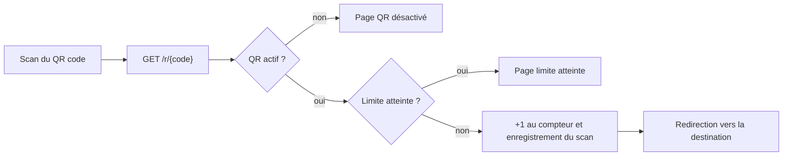

<div align="center">

# ScanTrack

**Générez. Partagez. Suivez chaque scan.**

Plateforme web de génération et de gestion de codes QR dynamiques,
avec limite de scans et historique détaillé.


</div>

<!-- Ajouter ici une capture d'écran du tableau de bord :  -->

## Présentation

ScanTrack est le **Projet 6** de la liste des projets web IFRI 2026, réalisé par le **Groupe 12** (10 étudiants en Génie Logiciel, IFRI, Université d'Abomey-Calavi). Remise prévue le **11 décembre 2026**.

Contrairement à un générateur de QR classique, ScanTrack produit des codes **dynamiques** : le QR code ne contient pas l'adresse finale, mais un lien court vers la plateforme. C'est ce qui permet de **compter les scans, de les limiter et de les analyser**, et de modifier la destination ou la limite sans réimprimer le QR.

## Fonctionnalités

| Fonctionnalité | Statut |
|---|---|
| Modèle de données (utilisateurs, QR codes, scans) et squelette Laravel | Fait |
| Authentification (inscription, connexion) | En cours |
| Création de QR codes : URL, texte, e-mail, SMS, WiFi, vCard | À faire |
| Personnalisation : couleurs, logo, téléchargement PNG et SVG | À faire |
| Redirection `/r/{code}` avec limite de scans (modifiable, ou illimitée) | À faire |
| Historique des scans : date, adresse IP, pays, ville | À faire |
| Filtres par période et par zone géographique | À faire |
| Tableau de bord : statistiques, courbe d'évolution, carte des scans | À faire |
| Exports CSV et PDF | À faire |

## Comment fonctionne un scan



L'incrément du compteur est conditionnel (`scan_count < max_scans`) pour que deux scans simultanés ne dépassent jamais la limite.

## Stack technique

| Couche | Technologies |
|---|---|
| Backend (API) | PHP 8.2+, Laravel, Laravel Sanctum |
| Frontend | React (Vite), JavaScript |
| Base de données | SQLite en développement |
| Graphiques et carte (prévu) | Recharts, Leaflet, OpenStreetMap |
| Géolocalisation par IP (prévu) | GeoLite2 |

## Structure du dépôt

```
ScanTrack/
├── backend/     API Laravel : modèles, migrations, routes
└── frontend/    Interface React (Vite)
```

## Modèle de données

**`qr_codes`** : `user_id`, `name`, `type`, `content`, `short_code` (unique), `max_scans` (vide = illimité), `scan_count`, `is_active`, `foreground_color`, `background_color`, `logo_path`

**`scans`** : `qr_code_id`, `ip_address`, `country`, `city`, `latitude`, `longitude`, `device`, `user_agent`, `scanned_at`

## Installation

**Prérequis :** Git, PHP 8.2+, Composer, Node.js 18+.
Sous Windows, [Laragon](https://laragon.org) installe PHP et Composer en une fois. Un GitHub Codespace fonctionne aussi sans rien installer.

```bash
git clone https://github.com/Amen-pixel/Projet_6_Groupe12_ScanTrack.git
cd Projet_6_Groupe12_ScanTrack/backend

composer install
cp .env.example .env
php artisan key:generate
php artisan migrate        # accepter la création du fichier SQLite
php artisan serve
```

L'API tourne alors sur `http://127.0.0.1:8000`.

Le frontend sera documenté ici dès que son dossier `frontend/` sera en place.

## Organisation de l'équipe

Le groupe est réparti en 5 binômes, chacun livrant une fonctionnalité complète (une personne sur le back, l'autre sur le front).

| Binôme | Responsabilité |
|---|---|
| 1 | Authentification et comptes |
| 2 | Création et personnalisation des QR codes |
| 3 | Moteur de scan et limite de scans |
| 4 | Historique et statistiques |
| 5 | Tableau de bord, exports, documentation, déploiement |

La liste des contributeurs est visible dans l'onglet **Insights → Contributors** du dépôt.

## Contribuer

1. Créer une branche par fonctionnalité : `feature/auth`, `feature/qr-creation`, `feature/scan-engine`, `feature/stats`, `feature/dashboard`.
2. Ne jamais pousser directement sur `main` : ouvrir une **Pull Request**, relue par un autre membre avant fusion.
3. Ne jamais modifier une migration déjà poussée : en créer une nouvelle.
4. Ne jamais versionner le fichier `.env` (seul `.env.example` l'est).

## Jalons

| Date | Objectif |
|---|---|
| 25 nov. | Squelette backend et frontend sur `main` |
| 29 nov. | Connexion, layout et création de QR (URL, texte) |
| 1 déc. | Premier scan réel enregistré |
| 6 déc. | Fin des fonctionnalités |
| 9 déc. | Intégration terminée, corrections uniquement |
| 11 déc. | Remise du projet |

## Crédits

Fonds de carte © contributeurs [OpenStreetMap](https://www.openstreetmap.org/copyright). Projet académique réalisé dans le cadre de la formation en Génie Logiciel de l'IFRI.
